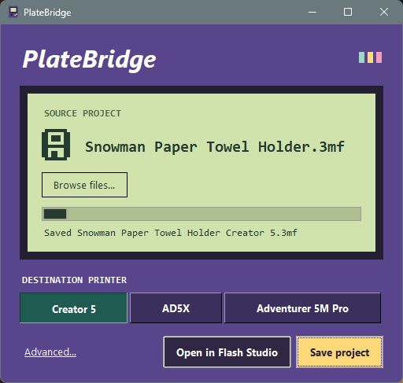

# PlateBridge

**[Download PlateBridge for Windows](https://github.com/redheadeddude-eng/PlateBridge/releases/download/2026-11-24/PlateBridge.zip)**

[Watch the 25-second MakerWorld to Flash Studio demo on YouTube](https://www.youtube.com/shorts/Hm1HkO1lTY0)

PlateBridge is a free Windows app for converting MakerWorld 3MF files into editable Flash Studio projects for the Flashforge AD5X, Adventurer 5M Pro, and Creator 5.

## Install and convert a project

1. Extract the download, run **PlateBridge-Setup.exe**, and choose **Install PlateBridge** or **Update PlateBridge**.
2. Drop the original MakerWorld 3MF into PlateBridge and select your printer.
3. Click **Save project**. The new 3MF sits next to the original with the printer name added.
4. Click **Open in Flash Studio**, check the plates and filament assignments, and slice.

PlateBridge carries over settings such as layer height, infill, supports and filament colors. Machine-specific settings come from the selected printer profile. The installer includes fallback profiles for all three supported printers.

[Download the demo video](PlateBridge-demo.mp4)

## Run from the published source on Windows

Download and extract the [source ZIP](https://github.com/redheadeddude-eng/PlateBridge/archive/refs/heads/main.zip). Install Python 3.14 for Windows with Tcl/Tk from [python.org](https://www.python.org/downloads/windows/). Open the extracted `app` folder and double-click **Open PlateBridge.pyw**. To see startup errors in a terminal, run `python app/PlateBridge.py` from the repository folder.

The packaged Windows installer is unsigned. If Windows Security reports a named threat, leave the file quarantined and report the detection name, affected filename, and PlateBridge version. Please omit personal folder paths.

## Build the Windows installer

With 64-bit Python 3.14 on PATH and the .NET Framework 4.x C# compiler installed, run `.\build\package.ps1` in PowerShell. The installer and distribution ZIP are written to `dist`.
